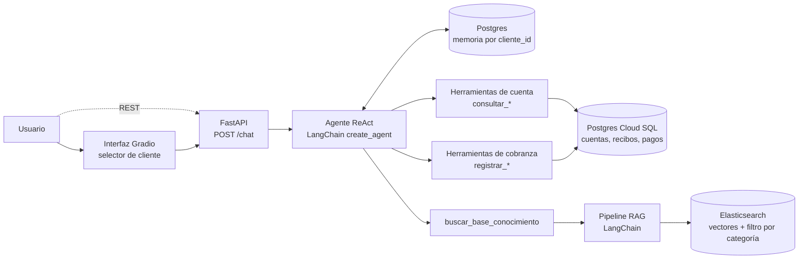

# Agente de cobranzas con RAG y memoria por cliente

Asistente conversacional para una empresa de telecomunicaciones que explica al cliente **su deuda pendiente y el detalle de su recibo**, registra **compromisos de pago** y responde **dudas conceptuales** (financiamiento, ciclo de facturación, prorrateo, billshock, medios de pago, débito automático) con RAG.

Proyecto final de la especialización en IA generativa. Parte del notebook `agente_deuda_recibo_V4` (módulos II, III y IV), llevado a un servicio desplegable: **API (FastAPI) + interfaz (Gradio) en un solo contenedor**, desplegado en **Google Cloud Run**.

## 1. Descripción del proyecto

**Problema.** Los clientes con deuda llaman al call center para preguntar cuánto deben, por qué su recibo es tan alto o cómo pagar. Es un proceso manual, caro y limitado al horario de atención; además, no queda registro estructurado de por qué un cliente no paga.

**Solución.** Un agente que conversa con el cliente, consulta sus datos reales en la base de cobranzas y, cuando la pregunta es conceptual, busca la respuesta en una base de conocimiento. Cada conversación tiene memoria propia.

**Flujo conversacional.**
1. El cliente saluda y el agente le pide su DNI (si no lo dio).
2. Consulta el estado de cuenta y el detalle del recibo; si la deuda está vencida, ofrece registrar un **compromiso de pago** y pide confirmación explícita del monto y la fecha antes de guardarlo.
3. Si el cliente muestra que no va a pagar, pregunta el motivo y lo registra como **gestión de cobranza**.
4. Si pregunta algo conceptual ("¿en cuántas cuotas puedo financiar?"), el agente usa RAG y responde solo con lo que dice la base de conocimiento.
5. Lo que está fuera de alcance (cambio de plan, soporte técnico) se deriva al canal correcto; ante un error de sistema, ofrece un asesor humano.

## 2. Arquitectura



| Componente | Rol | Código |
|---|---|---|
| **Agente** | ReAct simple con `create_agent`: en cada turno decide qué herramienta usar. El prompt del sistema define las 11 reglas de negocio. | `app/agent.py`, `app/prompts.py` |
| **Memoria** | `PostgresSaver` de LangGraph. La clave es el `thread_id` = ID del cliente, así cada cliente solo ve su historial y sobrevive a reinicios. | `app/agent.py`, `app/db.py` |
| **Herramientas (7)** | Cuenta: `consultar_estado_cuenta`, `consultar_detalle_recibo`, `consultar_historial_pagos`. Cobranza: `registrar_compromiso_pago`, `registrar_gestion_cobranza`. Utilidad: `obtener_fecha_actual`. Conocimiento: `buscar_base_conocimiento`. | `app/tools/` |
| **Pipeline RAG** | Carga de `.md` con metadata → chunking → embeddings (OpenAI `text-embedding-3-small`) → indexación → recuperación. | `app/rag/`, `scripts/ingest.py` |
| **Vector store + filtros** | Elasticsearch. La herramienta acepta una `categoria` (`financiamiento`, `facturacion`, `pagos`) que se aplica como filtro de metadata. | `app/rag/langchain_rag.py` |
| **API** | FastAPI: `/chat`, `/historial/{id}`, `/health`, `/ready`, `/docs`. | `app/main.py` |
| **Interfaz** | Gradio: caja de texto, respuesta del modelo, historial y selector de cliente. | `app/ui.py` |

## 3. Stack tecnológico

Python 3.12 · LangChain 1.x y LangGraph · OpenAI (`gpt-4o`, embeddings `text-embedding-3-small`) · PostgreSQL en Cloud SQL (datos de cobranza y memoria) · Elasticsearch 8 en una VM de GCP · FastAPI + Uvicorn · Gradio 6 · Docker · Google Cloud Run. Opcional: LlamaIndex como alternativa para el RAG, y LangSmith para trazas.

## 4. Estructura del código

```
agente-cobranzas/
├── app/
│   ├── main.py            # FastAPI + Gradio montado en "/"
│   ├── ui.py              # interfaz: vista de cliente (chat) y vista de administrador
│   ├── admin.py           # consultas de compromisos de pago y motivos de no pago + clave
│   ├── agent.py           # create_agent, memoria, chat()/historial()/reiniciar()
│   ├── prompts.py         # prompt del sistema
│   ├── config.py          # variables de entorno, validación de IDs, hora de Lima
│   ├── db.py              # pools de conexión a Postgres
│   ├── tools/             # las 7 herramientas del agente
│   └── rag/               # documentos.py + langchain_rag.py (por defecto) + llamaindex_rag.py (opcional)
├── base_conocimiento/     # documentos .md con frontmatter (tema, categoria, titulo, palabras_clave)
├── scripts/
│   ├── ingest.py          # indexa la base de conocimiento en Elasticsearch
│   └── probar_agente.py   # prueba de humo por consola
├── tests/test_app.py      # pruebas sin servicios externos
├── clientes_demo.json     # clientes de la demo (ID de memoria + DNI de prueba)
├── Dockerfile · requirements*.txt · .env.example
```

## 5. Ejecutar en local

Requisitos: Python 3.12, una API key de OpenAI, acceso a tu Postgres y a tu Elasticsearch (desde tu PC, con tu IP autorizada en Cloud SQL y en el firewall de la VM).

```bash
# 1) Entorno
python -m venv .venv
source .venv/bin/activate          # Windows: .venv\Scripts\activate
pip install -r requirements.txt

# 2) Configuración
cp .env.example .env               # Windows: copy .env.example .env   → completa los valores

# 3) Base de conocimiento: copia tus .md a base_conocimiento/ e indexa (una sola vez)
python -m scripts.ingest

# 4) Levantar la app
uvicorn app.main:app --reload --port 8080
```

Abre <http://localhost:8080>. Para cambiar los documentos de la base de conocimiento, edita los `.md` y corre `python -m scripts.ingest --reset`.

## 6. Cómo probar el agente

**En la interfaz** (<http://localhost:8080> o la URL de Cloud Run). Cada opción del selector es un cliente con su propia memoria; el botón *Escribir saludo con el DNI de prueba* rellena el primer mensaje.

| Cliente | Qué mostrar |
|---|---|
| Cliente 1 | Deuda → detalle del recibo → "me comprometo a pagar mañana" → el agente pide confirmación y registra el compromiso. |
| Cliente 2 | Responde "no" al compromiso → el agente pregunta el motivo y lo registra como gestión de cobranza. |
| Cliente 3 | Deuda y luego preguntas conceptuales (cuotas, ciclo de facturación, medios de pago): respuestas con RAG. |
| Cliente 4 | DNI inexistente: manejo de error y derivación a un asesor. |

Para mostrar **memoria separada**: habla con el Cliente 1, cambia al Cliente 2 (el chat queda en blanco y no sabe nada del primero) y vuelve al Cliente 1 (recupera su conversación). *Reiniciar memoria* deja a un cliente en blanco para repetir la demo.

**Por la API** (documentación interactiva en `/docs`):

```bash
curl -X POST http://localhost:8080/chat -H "Content-Type: application/json" \
  -d '{"cliente_id": "cliente-001", "mensaje": "Hola, quiero saber cuánto debo. Mi DNI es 10234567"}'
```

**Por consola:** `python -m scripts.probar_agente` repite las conversaciones del notebook con IDs `prueba-00N` y muestra cuántos mensajes guardó la memoria de cada uno. Ojo: usa las herramientas reales, así que escribe en tu base.

**Tests:** `pip install -r requirements-dev.txt && pytest` (no necesitan Postgres, Elasticsearch ni OpenAI).

## 7. Desplegar en Cloud Run

Ejecuta los comandos en **Cloud Shell** (bash, con `gcloud` ya instalado) después de clonar el repo, o en Git Bash. Ajusta los valores en mayúsculas.

```bash
PROYECTO=TU_PROYECTO_GCP
REGION=us-east1                      # la región de tu Cloud SQL y de tu VM
SERVICIO=agente-cobranzas
INSTANCIA=$PROYECTO:$REGION:NOMBRE_INSTANCIA_CLOUD_SQL
gcloud config set project $PROYECTO

# 1) Activar las APIs necesarias
gcloud services enable run.googleapis.com cloudbuild.googleapis.com artifactregistry.googleapis.com \
  secretmanager.googleapis.com sqladmin.googleapis.com compute.googleapis.com

# 2) Guardar los secretos (no van en el repo ni en el Dockerfile)
printf '%s' 'TU_API_KEY_OPENAI'  | gcloud secrets create openai-api-key --data-file=-
printf '%s' 'TU_PASSWORD_PG'     | gcloud secrets create pg-password    --data-file=-
printf '%s' 'TU_PASSWORD_ES'     | gcloud secrets create es-password    --data-file=-
printf '%s' 'CLAVE_DEL_ADMIN'    | gcloud secrets create admin-password --data-file=-

# 3) Permisos para la cuenta con la que corre Cloud Run
SA="$(gcloud projects describe $PROYECTO --format='value(projectNumber)')-compute@developer.gserviceaccount.com"
for S in openai-api-key pg-password es-password admin-password; do
  gcloud secrets add-iam-policy-binding $S --member="serviceAccount:$SA" --role=roles/secretmanager.secretAccessor
done
gcloud projects add-iam-policy-binding $PROYECTO --member="serviceAccount:$SA" --role=roles/cloudsql.client

# 4) IP interna de la VM de Elasticsearch
gcloud compute instances list --format="table(name,zone.basename(),networkInterfaces[0].networkIP)"

# 5) Desplegar (Cloud Build construye el Dockerfile)
gcloud run deploy $SERVICIO --source . --region $REGION \
  --allow-unauthenticated --memory 1Gi --cpu-boost --max-instances 1 \
  --add-cloudsql-instances $INSTANCIA \
  --network default --subnet default --vpc-egress private-ranges-only \
  --set-env-vars "PG_HOST=/cloudsql/$INSTANCIA,PG_DB=TU_DB,PG_USER=TU_USUARIO,ES_URL=http://IP_INTERNA_VM:9200,ES_USER=elastic,RAG_BACKEND=langchain,OPENAI_MODEL=gpt-4o" \
  --set-secrets "OPENAI_API_KEY=openai-api-key:latest,PG_PASSWORD=pg-password:latest,ES_PASSWORD=es-password:latest,ADMIN_PASSWORD=admin-password:latest"
```

Al terminar, `gcloud` imprime la URL del servicio (`https://agente-cobranzas-xxxx.a.run.app`).

**Verificar el despliegue**
1. `https://TU-URL/health` debe responder `{"status":"ok"}`.
2. `https://TU-URL/ready` comprueba Postgres y Elasticsearch: si algo falla, indica cuál; el detalle completo está en *Cloud Run → Registros*.
3. Abre `https://TU-URL/` y haz la demo del punto 6.

**Por qué esta configuración**
- **Cloud SQL por socket (`/cloudsql/...`):** Cloud Run no tiene IP fija, así que no se puede "autorizar su IP" en Cloud SQL. El socket evita abrir la base a internet y no requiere SSL aparte.
- **Elasticsearch por IP interna (Direct VPC egress):** el tráfico va por la red privada de GCP (la red `default` ya permite el tráfico interno). Si prefieres usar la IP pública de la VM, quita `--network/--subnet/--vpc-egress` y habilita el puerto 9200 en el firewall, aunque eso deja Elasticsearch expuesto.
- **`--max-instances 1`:** la cola de Gradio vive en la memoria de la instancia; con varias instancias una petición puede caer en otra y fallar. Con una sola instancia las llamadas al LLM (E/S) se atienden en paralelo sin problema.
- **Día de la presentación:** agrega `--min-instances 1` para evitar el arranque en frío (unos segundos) y quítalo después (`--min-instances 0`).

**Actualizar:** repite el paso 5. **Dar de baja el servicio** al terminar la evaluación: `gcloud run services delete $SERVICIO --region $REGION`.

## 8. Decisiones de diseño

- **RAG con LangChain (y no LlamaIndex).** El enunciado del proyecto final pide "Pipeline RAG usando LangChain", es una sola librería con llamadas síncronas y el contenedor queda más liviano. La versión de LlamaIndex del módulo IV se conserva como alternativa: `RAG_BACKEND=llamaindex`, `pip install -r requirements-llamaindex.txt` y usa su propio índice (`base_conocimiento_telecom_llamaindex`).
- **Un solo servicio.** La API y la interfaz comparten contenedor: la API cumple el rol de backend (`/chat`) y Gradio es el frontend. Si más adelante quieres un frontend aparte (por ejemplo en Vercel), define `CORS_ORIGINS` y consume `/chat`.
- **Memoria en Postgres, no en RAM.** Sobrevive a reinicios y al escalado de Cloud Run.
- **Hora de Lima.** Cloud Run corre en UTC; sin corrección, después de las 7 p. m. el agente pensaría que "hoy" ya es mañana al calcular mora o fechas de compromiso.
- **Errores visibles en los logs.** Las herramientas devuelven `ERROR: ...` al agente (como en el notebook) y además registran la causa real en el log del servicio.

## 9. Variables de entorno

| Variable | Obligatoria | Descripción |
|---|---|---|
| `OPENAI_API_KEY` | sí | Clave de OpenAI |
| `OPENAI_MODEL` | no | Modelo del agente (por defecto `gpt-4o`) |
| `PG_HOST`, `PG_DB`, `PG_USER`, `PG_PASSWORD` | sí | Postgres. En Cloud Run, `PG_HOST=/cloudsql/PROYECTO:REGION:INSTANCIA` |
| `PG_PORT`, `PG_SSLMODE` | no | Por defecto `5432` y `require` |
| `ES_URL`, `ES_PASSWORD` | sí | Elasticsearch (`http://host:9200`) |
| `ES_USER`, `ES_INDEX` | no | Por defecto `elastic` y el índice de cada backend |
| `ADMIN_PASSWORD` | no | Clave de la vista de administrador. Si falta, esa vista queda desactivada |
| `RAG_BACKEND` | no | `langchain` (por defecto) o `llamaindex` |
| `LANGSMITH_TRACING`, `LANGSMITH_API_KEY`, `LANGSMITH_PROJECT` | no | Trazas en LangSmith |
| `APP_TZ`, `CORS_ORIGINS` | no | Zona horaria (`America/Lima`) y orígenes permitidos para CORS |

## 10. Limitaciones y seguridad

- **Vista de administrador:** muestra nombres, DNI, compromisos de pago y motivos de no pago (consultas de solo lectura, máximo 500 filas, DNI como parámetro SQL). Está protegida por una clave única (`ADMIN_PASSWORD`, guardada en Secret Manager); es suficiente para la demo, pero un sistema real necesitaría usuarios, roles y registro de accesos.
- **Identificación por DNI dicho en el chat:** es suficiente para la demo, pero un sistema real debe autenticar al cliente antes de mostrarle datos de deuda.
- **La URL pública consume tu cuota de OpenAI y puede escribir en tu base** (compromisos y gestiones). No la compartas fuera de la evaluación, pon un límite de gasto en OpenAI y da de baja el servicio al terminar.
- Las reglas de financiamiento de la base de conocimiento (cuotas, montos) son valores de ejemplo, no datos oficiales.
- El `.env` y las claves nunca se suben a GitHub (están en `.gitignore`).
